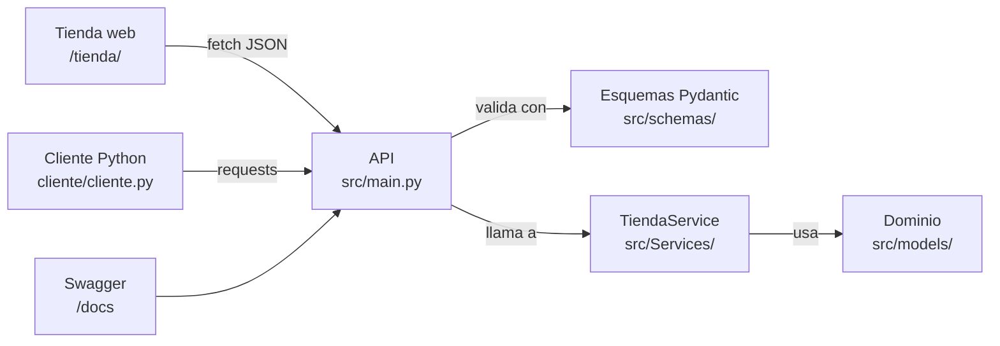

# Tienda Online API — DevOps Práctica

[](https://github.com/martaariaasss/marta-arias-devops-practica/actions/workflows/ci.yml)
[](https://hub.docker.com/r/martaariasss/tienda-online-api)

**Autora:** Marta Arias
**Asignatura:** Arquitectura de Software — Universidad Intercontinental de la Empresa (UIE)
**Repositorio:** https://github.com/martaariaasss/marta-arias-devops-practica

## Descripción

Aplicación Python de una **tienda online**: una **API REST** construida con **FastAPI** y
**Pydantic** sobre una capa de dominio orientada a objetos, más una **tienda web** (frontend)
y un **cliente Python** que la consumen.

- **Dominio** (`src/models/`): `Producto`, `ProductoElectronico`, `ProductoRopa`, `Usuario`,
  `Cliente`, `Administrador`, `Pedido` y `LineaPedido`.
- **Lógica de negocio** (`src/Services/`): `TiendaService` gestiona usuarios, productos y
  pedidos en memoria y lanza excepciones de dominio cuando algo falla.
- **API** (`src/main.py` + `src/schemas/`): expone la funcionalidad mediante endpoints HTTP,
  valida las entradas con esquemas Pydantic y traduce las excepciones de dominio a
  códigos HTTP.
- **Tienda web** (`src/frontend/index.html`): página que la propia API sirve en `/tienda/` y
  que permite ver y crear productos y usuarios, hacer pedidos y consultar el historial.
- **Cliente Python** (`cliente/cliente.py`): script con `requests` que recorre el flujo
  completo de la tienda usando solo la API.

Este repositorio aplica el ciclo DevOps completo: control de versiones con Git y GitHub
(ramas `feature/*`, commits descriptivos y Pull Requests), **contenerización con Docker**,
publicación de la imagen en **Docker Hub** e integración continua con **GitHub Actions**.

---

## Índice

1. [Arquitectura](#1-arquitectura)
2. [Ejecución en local (sin Docker)](#2-ejecución-en-local-sin-docker)
3. [Docker](#3-docker)
   - [3.1 Construir la imagen](#31-construir-la-imagen)
   - [3.2 Ejecutar el contenedor](#32-ejecutar-el-contenedor)
   - [3.3 Variables de entorno](#33-variables-de-entorno)
   - [3.4 Salida esperada y pruebas](#34-salida-esperada-y-pruebas)
   - [3.5 Publicar y descargar la imagen (Docker Hub)](#35-publicar-y-descargar-la-imagen-docker-hub)
   - [3.6 Flujo automatizado build → run → test → push](#36-flujo-automatizado-build--run--test--push)
   - [3.7 Docker Compose](#37-docker-compose)
   - [3.8 Decisiones de diseño del Dockerfile](#38-decisiones-de-diseño-del-dockerfile)
4. [API: endpoints](#4-api-endpoints)
5. [Tests](#5-tests)
6. [Integración continua](#6-integración-continua)
7. [Flujo de trabajo con Git](#7-flujo-de-trabajo-con-git)
8. [Estructura del repositorio](#8-estructura-del-repositorio)

---

## 1. Arquitectura

Arquitectura en capas: cada capa solo conoce a la de debajo, y la lógica de negocio no
sabe nada de HTTP. Los tres clientes (Swagger, la tienda web y el cliente Python) usan
los mismos endpoints y trabajan sobre los mismos datos.



Flujo de una petición: `main.py` recibe la petición → Pydantic valida el cuerpo con el
esquema `*Create` → se llama a `TiendaService`, que usa las clases de dominio → el
resultado se convierte al esquema `*Read` y se devuelve como JSON. Si el servicio lanza
una excepción de dominio, `main.py` la traduce al código HTTP correspondiente. Para que la
tienda web pueda llamar a la API desde otro origen, `main.py` activa CORS.

La configuración (host, puerto, logs, datos de ejemplo…) se lee de **variables de entorno**
(`src/config.py`), así que la misma imagen sirve para cualquier entorno.

---

## 2. Ejecución en local (sin Docker)

Requiere Python 3.10 o superior.

```bash
python -m venv .venv
# Windows:      .venv\Scripts\activate
# Linux/macOS:  source .venv/bin/activate
pip install -r requirements-dev.txt

cd src
python main.py            # o: uvicorn main:app --reload
```

`python main.py` escucha en `0.0.0.0:8000` (acepta conexiones de otros equipos de la red) y
muestra en la consola las direcciones:

- **Tienda web:** http://localhost:8000/tienda/
- Swagger UI: http://localhost:8000/docs
- ReDoc: http://localhost:8000/redoc

Los datos se guardan en memoria y se pierden al reiniciar. Al arrancar se cargan los datos
de ejemplo de la Práctica 1: 3 clientes (Ana García, Luis Pérez y María López), 1
administrador (Carlos Admin) y 5 productos (Portátil, Móvil, Camiseta, Pantalón y Taza de
cerámica).

### Tienda web

`src/frontend/index.html` es un cliente independiente que se comunica con la API mediante
`fetch`; FastAPI solo sirve el fichero en `/tienda/`. Toda la comunicación pasa por la
función `api(metodo, ruta, cuerpo)` del `<script>`, que comprueba el código HTTP y muestra
el `detail` de los errores. La dirección del servidor se puede cambiar en el cuadro
"Servidor API" de la parte superior (por ejemplo, para usar la API de otro equipo).

| Acción en la página | Endpoint |
| --- | --- |
| Ver productos | `GET /productos` |
| Crear producto | `POST /productos` |
| Eliminar producto | `DELETE /productos/{id}` |
| Ver usuarios | `GET /usuarios` |
| Crear usuario | `POST /usuarios` |
| Crear pedido | `POST /pedidos` |
| Pedidos de un usuario | `GET /usuarios/{cliente_id}/pedidos` |

### Cliente Python

Con la API arrancada, `cliente/cliente.py` ejecuta el flujo completo: crear un usuario →
listar usuarios → crear dos productos → listar productos → crear un pedido → consultar los
pedidos del usuario. La dirección de la API está en la constante `BASE_URL`.

```bash
python cliente/cliente.py
```

### Comunicación entre dos equipos

En el equipo servidor se ejecuta `python main.py` (o el contenedor Docker). En el otro equipo
se usa la IP del servidor en lugar de `localhost`: `http://<ip-del-servidor>:8000/tienda/`,
`/docs` o `BASE_URL` en el cliente Python. Si Windows pregunta por el firewall, hay que
permitir el acceso en redes privadas.

---

## 3. Docker

Requisito: [Docker Desktop](https://www.docker.com/products/docker-desktop/) (Windows/macOS)
o Docker Engine (Linux). Todos los comandos se ejecutan desde la **raíz del repositorio**.

### 3.1 Construir la imagen

```bash
docker build -t martaariasss/tienda-online-api:1.0.0 .
```

Con varias etiquetas y la versión de la app (aparece en `/health` y en `/docs`):

```bash
docker build --build-arg APP_VERSION=1.0.0 \
  -t martaariasss/tienda-online-api:1.0.0 \
  -t martaariasss/tienda-online-api:latest .
```

> En PowerShell, sustituye la barra invertida `\` de final de línea por el acento grave `` ` ``,
> o escribe el comando en una sola línea.

Comprobar la imagen:

```bash
docker image ls martaariasss/tienda-online-api
docker history martaariasss/tienda-online-api:1.0.0     # capas de la imagen
```

### 3.2 Ejecutar el contenedor

Ejecución básica (en primer plano, se elimina al pararlo con `Ctrl+C`):

```bash
docker run --rm -p 8000:8000 martaariasss/tienda-online-api:1.0.0
```

Con el contenedor en marcha, la **tienda** está en **http://localhost:8000/tienda/** y la
documentación de la API en http://localhost:8000/docs.

En segundo plano, con nombre:

```bash
docker run -d --name tienda-api -p 8000:8000 martaariasss/tienda-online-api:1.0.0
docker ps                       # estado: "Up ... (healthy)"
docker logs -f tienda-api       # ver logs
docker stop tienda-api && docker rm tienda-api
```

Publicando en otro puerto del equipo (8080) y con logs de depuración:

```bash
docker run --rm -p 8080:8000 -e LOG_LEVEL=debug martaariasss/tienda-online-api:1.0.0
```

Cambiando el puerto interno de la app:

```bash
docker run --rm -p 9000:9000 -e PORT=9000 martaariasss/tienda-online-api:1.0.0
```

Con un fichero de variables (copia `.env.example` como `.env`):

```bash
docker run --rm -p 8000:8000 --env-file .env martaariasss/tienda-online-api:1.0.0
```

Con el máximo endurecimiento (sistema de ficheros de solo lectura y sin capacidades extra):

```bash
docker run --rm -p 8000:8000 --read-only --tmpfs /tmp --cap-drop ALL \
  --security-opt no-new-privileges:true martaariasss/tienda-online-api:1.0.0
```

### 3.3 Variables de entorno

| Variable               | Valor por defecto | Descripción |
| ---------------------- | ----------------- | ----------- |
| `HOST`                 | `0.0.0.0`         | Interfaz en la que escucha el servidor. `0.0.0.0` acepta conexiones desde fuera del contenedor y desde otros equipos. |
| `PORT`                 | `8000`            | Puerto interno de la aplicación (1–65535). |
| `LOG_LEVEL`            | `info`            | `critical`, `error`, `warning`, `info`, `debug` o `trace`. |
| `CARGAR_DATOS_EJEMPLO` | `true`            | Carga al arrancar los usuarios y productos de ejemplo de la Práctica 1. Con `false` la tienda arranca vacía. |
| `APP_VERSION`          | `1.0.0` (o `--build-arg APP_VERSION`) | Versión mostrada en `/health` y en la documentación. |

Ejemplo, tienda vacía y con logs de depuración:

```bash
docker run --rm -p 8000:8000 -e CARGAR_DATOS_EJEMPLO=false -e LOG_LEVEL=debug martaariasss/tienda-online-api:1.0.0
```

Si una variable tiene un valor no válido (p. ej. `PORT=abc`), la aplicación **no arranca** y
muestra un error claro (*fail fast*). La aplicación **no usa secretos**; si en el futuro los
necesitara, se pasarían con `-e` o `--env-file` y nunca se incluirían en la imagen ni en Git
(`.env` está en `.gitignore` y en `.dockerignore`).

### 3.4 Salida esperada y pruebas

**Al arrancar el contenedor** debe imprimirse:

```text
API en este equipo:   http://localhost:8000/docs
API desde otro equipo: http://172.17.0.2:8000/docs
Frontend:              http://localhost:8000/tienda/
INFO:     Started server process [1]
INFO:     Waiting for application startup.
INFO:     Application startup complete.
INFO:     Uvicorn running on http://0.0.0.0:8000 (Press CTRL+C to quit)
```

(La IP de la segunda línea es la interna del contenedor; desde tu equipo se usa
`localhost`.) A los pocos segundos `docker ps` muestra el contenedor como **`(healthy)`**.

**Prueba en el navegador:** abre **http://localhost:8000/tienda/**. Deben aparecer los 5
productos de ejemplo; crea un pedido desde la página y comprueba que baja el stock.

**Pruebas manuales con la API** (en Windows PowerShell usa `curl.exe` en lugar de `curl`):

```bash
# 1. Salud de la API
curl http://localhost:8000/health
# -> {"status":"ok","version":"1.0.0"}

# 2. Catálogo (5 productos de ejemplo)
curl http://localhost:8000/productos

# 3. Pedido: la cliente 1 (Ana García) compra 2 portátiles (producto 1)
curl -X POST http://localhost:8000/pedidos -H "Content-Type: application/json" \
  -d '{"cliente_id":1,"items":[{"producto_id":1,"cantidad":2}]}'
# -> 201 {"id":1, ..., "nombre_cliente":"Ana García", "total":1799.98, ...}

# 4. Historial de la cliente y error 404
curl http://localhost:8000/usuarios/1/pedidos
curl http://localhost:8000/productos/999          # -> 404 {"detail":"Producto con id 999 no encontrado"}
```

**Smoke test automático** (contra un contenedor recién arrancado; no necesita dependencias):

```bash
python scripts/smoke_test.py http://localhost:8000
```

Salida esperada:

```text
Smoke test contra http://localhost:8000
  [OK] GET /health -> 200 y status ok
  [OK] GET /docs (Swagger UI) -> 200
  [OK] GET /tienda/ (frontend de la tienda) -> 200
  [OK] POST /usuarios (cliente) -> 201
  [OK] POST /usuarios con email repetido -> 409
  [OK] POST /productos (electrónico) -> 201
  [OK] POST /productos sin meses_garantia -> 422
  [OK] POST /pedidos -> 201 con total 1799.98
  [OK] El stock baja de 10 a 8
  [OK] GET /usuarios/{id}/pedidos -> 1 pedido
  [OK] GET /productos/9999 -> 404
RESULTADO: TODO CORRECTO
```

Comprobar que el contenedor **no se ejecuta como root**:

```bash
docker exec tienda-api whoami      # -> app
```

### 3.5 Publicar y descargar la imagen (Docker Hub)

**Publicar** (push):

```bash
docker login                                         # usuario + token de acceso de Docker Hub
docker push martaariasss/tienda-online-api:1.0.0
docker push martaariasss/tienda-online-api:latest
```

**Descargar y ejecutar** desde cualquier equipo (pull):

```bash
docker pull martaariasss/tienda-online-api:1.0.0
docker run --rm -p 8000:8000 martaariasss/tienda-online-api:1.0.0
```

Página de la imagen: https://hub.docker.com/r/martaariasss/tienda-online-api

Estrategia de etiquetado:

| Etiqueta      | Ejemplo        | Uso |
| ------------- | -------------- | --- |
| `X.Y.Z`       | `1.0.0`        | Versión semántica inmutable; la que se usa para desplegar. |
| `latest`      | `latest`       | Apunta a la última versión publicada. |
| `sha-<commit>`| `sha-a1b2c3d`  | Trazabilidad exacta entre la imagen y el commit que la generó. |

### 3.6 Flujo automatizado build → run → test → push

Los scripts de `scripts/` ejecutan el flujo completo: construyen la imagen con las tres
etiquetas, arrancan el contenedor, esperan a que esté *healthy*, lanzan el smoke test,
verifican que no corre como root y, opcionalmente, publican la imagen.

```powershell
# Windows (PowerShell)
.\scripts\docker_flow.ps1 -DockerHubUser martaariasss              # build, run y test
.\scripts\docker_flow.ps1 -DockerHubUser martaariasss -Push        # ... y push
```

```bash
# Linux / macOS / Git Bash
./scripts/docker_flow.sh martaariasss 1.0.0           # build, run y test
./scripts/docker_flow.sh martaariasss 1.0.0 --push    # ... y push
```

> Si PowerShell bloquea el script, ejecuta antes:
> `Set-ExecutionPolicy -Scope Process -ExecutionPolicy Bypass`

### 3.7 Docker Compose

```bash
docker compose up --build -d     # construye y arranca (http://localhost:8000)
docker compose ps                # estado (healthy)
docker compose logs -f
docker compose down
```

`compose.yaml` aplica además endurecimiento: sistema de ficheros de solo lectura,
`cap_drop: ALL` y `no-new-privileges`.

### 3.8 Decisiones de diseño del Dockerfile

| Práctica | Cómo se aplica | Por qué |
| -------- | -------------- | ------- |
| Imagen base ligera | `python:3.12-slim` | Menor tamaño y menos superficie de ataque que la imagen completa. |
| Build multi-stage | Etapa `builder` instala dependencias en `/opt/venv`; la etapa final solo copia el venv | La imagen final no lleva caché de pip ni herramientas de instalación. |
| Caché de capas | `COPY requirements.txt` + `pip install` **antes** de `COPY src/` | Cambiar el código no obliga a reinstalar las dependencias. |
| Sin caché de pip | `pip install --no-cache-dir`, `PIP_NO_CACHE_DIR=1` | Imagen más pequeña. |
| Dependencias fijadas | `requirements.txt` con `==` | Builds reproducibles. |
| Solo dependencias de producción | `pytest`/`httpx` en `requirements-dev.txt` | No se incluyen herramientas de test en la imagen. |
| Usuario sin privilegios | `useradd ... app` + `USER app` (uid 10001) | Si la app se viera comprometida, el atacante no sería root. |
| Permisos mínimos | Código de `root:app`, `chmod u=rwX,g=rX,o=` | El usuario `app` puede leer y ejecutar el código, pero no modificarlo. |
| `.dockerignore` | Excluye `.git`, `tests/`, cachés, `.venv`, `.env`… | Contexto de build pequeño, sin secretos ni basura. |
| Healthcheck | `HEALTHCHECK` sobre `GET /health` | Docker sabe si la API responde de verdad, no solo si el proceso existe. |
| Configuración externa | `ENV` + variables en tiempo de ejecución | La misma imagen sirve para cualquier entorno (12-factor). |
| Logs a stdout | `PYTHONUNBUFFERED=1` | `docker logs` muestra los logs al instante. |
| `CMD` en forma exec | `CMD ["python", "main.py"]` | El proceso recibe directamente `SIGTERM` y se detiene de forma ordenada. |
| Metadatos | Etiquetas `org.opencontainers.image.*` | Autoría y versión consultables con `docker inspect`. |

---

## 4. API: endpoints

| Método | Ruta | Descripción | Códigos |
| --- | --- | --- | --- |
| GET | `/` | Mensaje de bienvenida | 200 |
| GET | `/health` | Estado de salud y versión | 200 |
| GET | `/tienda/` | Tienda web (frontend) | 200 |
| POST | `/usuarios` | Crea un usuario (cliente o administrador) | 201, 409, 422 |
| GET | `/usuarios` | Lista los usuarios | 200 |
| GET | `/usuarios/{usuario_id}` | Devuelve un usuario | 200, 404 |
| POST | `/productos` | Crea un producto (generico, electronico o ropa) | 201, 422 |
| GET | `/productos` | Lista los productos | 200 |
| GET | `/productos/{producto_id}` | Devuelve un producto | 200, 404 |
| DELETE | `/productos/{producto_id}` | Elimina un producto | 204, 404 |
| POST | `/pedidos` | Crea un pedido | 201, 400, 404, 422 |
| GET | `/usuarios/{cliente_id}/pedidos` | Historial de pedidos de un cliente (ordenado por fecha) | 200, 404 |

**Códigos HTTP:** `201` recurso creado · `204` producto eliminado · `400` stock insuficiente o
el usuario no es un cliente · `404` recurso inexistente · `409` email ya registrado ·
`422` datos que no cumplen el esquema (email mal formado, precio negativo, nombre vacío,
falta `meses_garantia` en un electrónico…).

**Reglas de validación**

- **Usuarios**: `tipo` es `cliente` o `administrador`; los clientes deben tener
  `direccion_postal`; el email debe tener formato válido y ser único.
- **Productos**: `precio` ≥ 0 y `stock` ≥ 0. Los `electronico` requieren `meses_garantia`;
  los de `ropa` requieren `talla` y `color`; un producto no admite atributos de otro tipo.
- **Pedidos**: al menos una línea y cantidades > 0. Se comprueba que exista el cliente,
  que sea un cliente (no un administrador), que existan los productos y que haya stock.
  Todo se valida antes de descontar stock, así un pedido fallido no modifica nada.

---

## 5. Tests

```bash
pip install -r requirements-dev.txt
python -m pytest -v
```

| Fichero | Qué prueba |
| ------- | ---------- |
| `tests/test_api.py` | Todos los endpoints de la API con `TestClient` (códigos HTTP y respuestas) y que la tienda web se sirve en `/tienda/`. |
| `tests/test_tienda_service.py` | Pruebas unitarias de `TiendaService` (lógica de negocio sin HTTP). |
| `tests/test_config.py` | Lectura y validación de las variables de entorno. |
| `scripts/smoke_test.py` | Prueba de humo contra el contenedor Docker en ejecución. |

---

## 6. Integración continua

El workflow `.github/workflows/ci.yml` (GitHub Actions) se ejecuta en cada push a `main` y
`feature/**` y en cada Pull Request hacia `main`:

1. **Tests**: instala `requirements-dev.txt` con Python 3.12 y ejecuta `pytest`.
2. **Docker**: ejecuta `scripts/docker_flow.sh` (build → run → healthcheck → smoke test → usuario no root).
3. **Push**: al crear una etiqueta `vX.Y.Z`, publica la imagen en Docker Hub con las etiquetas
   `X.Y.Z`, `latest` y `sha-<commit>`. Requiere los secretos del repositorio
   `DOCKERHUB_USERNAME` y `DOCKERHUB_TOKEN` (*Settings → Secrets and variables → Actions*).

---

## 7. Flujo de trabajo con Git

- **`main`**: rama estable y protegida. Solo recibe cambios mediante Pull Request con la CI en verde.
- **`feature/<nombre>`**: una rama por funcionalidad, de vida corta, creada desde `main`
  (p. ej. `feature/docker`).
- **Commits** pequeños con [Conventional Commits](https://www.conventionalcommits.org/es/):
  `feat`, `fix`, `docs`, `test`, `build`, `ci`, `chore`.
- **Pull Requests** con la plantilla `.github/pull_request_template.md` (descripción, pruebas y checklist).
- **Etiquetas**: `practica-3.1` marca la entrega de la Práctica 3.1; `v1.0.0` la primera
  versión publicada de la imagen.

```bash
git checkout main && git pull
git checkout -b feature/mi-cambio
# ... cambios + commits ...
git push -u origin feature/mi-cambio      # y abrir Pull Request hacia main
```

---

## 8. Estructura del repositorio

```text
marta-arias-devops-practica/
├── .github/
│   ├── workflows/ci.yml           CI: tests + build -> run -> test -> push
│   └── pull_request_template.md   Plantilla de Pull Request
├── src/                           Código fuente de la aplicación
│   ├── main.py                    Punto de entrada (main ejecutable) y endpoints
│   ├── config.py                  Configuración por variables de entorno
│   ├── models/                    Dominio: Producto, Usuario, Pedido...
│   ├── schemas/                   Esquemas Pydantic de entrada/salida
│   ├── Services/
│   │   └── Tienda_service.py      TiendaService + excepciones de dominio
│   └── frontend/
│       └── index.html             Tienda web (servida en /tienda/)
├── cliente/
│   └── cliente.py                 Cliente Python de la API (requests)
├── tests/                         Tests de API, servicio y configuración (pytest)
├── scripts/
│   ├── smoke_test.py              Prueba de humo contra el contenedor
│   ├── docker_flow.ps1            build -> run -> test -> push (Windows)
│   └── docker_flow.sh             build -> run -> test -> push (Linux/macOS)
├── Dockerfile                     Imagen multi-stage basada en python:3.12-slim
├── .dockerignore                  Ficheros excluidos del build
├── compose.yaml                   Arranque con Docker Compose
├── requirements.txt               Dependencias de ejecución (versiones fijadas)
├── requirements-dev.txt           Dependencias de desarrollo y tests
├── pytest.ini                     Configuración de pytest
├── .env.example                   Plantilla de variables de entorno
├── .gitignore / .gitattributes
└── README.md
```
